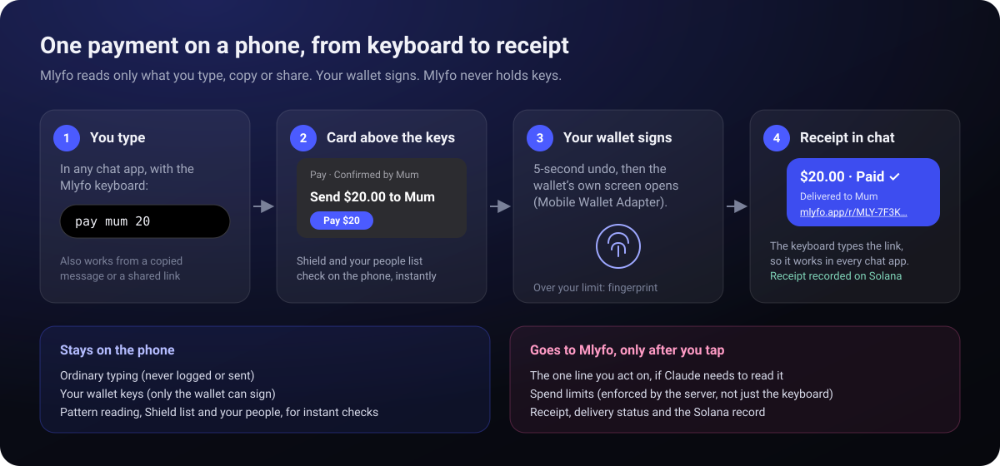

# Mlyfo

**The AI keyboard that can pay, and won't ship until Kane CLI says it works.**

Mlyfo puts a wallet inside your keyboard. It splits a bill four ways and collects each share. It blocks look-alike scam addresses. It holds back payments that go over your spend limits until you confirm them. Every one of those money flows is tested by [Kane CLI](https://www.testmuai.com/kane-cli/) in a real browser before a release. When a test fails, the failure goes back to the coding agent (Claude Code), which fixes the code and runs Kane again.

Built for the KaneCLI Online Hackathon (Web + Mobile category).

## Try it (judges)

**Live:** https://mlyfo.vercel.app (click **Try the demo account**). Kane's latest results are under **Verified by Kane** (`/app/verified`) once you sign in.

Or run it locally:

```bash
git clone <this repo> && cd mlyfo
npm install
npm run dev            # http://localhost:3100
```

| | |
|---|---|
| Demo login | `demo@mlyfo.app` / `mlyfo-demo-2026` (or click **Try the demo account** on the home page) |
| Node | 22.13 or newer. Locally the app keeps its data in a SQLite file in `data/`, so no database or keys are needed |
| Deploy | Vercel + Turso. Set `TURSO_DATABASE_URL` and `TURSO_AUTH_TOKEN`; the schema and demo data are created on first start |
| Money | Demo USDC only. New accounts start with $500. Nothing touches mainnet |
| Reset data | `npm run reset`, then restart `npm run dev` |

Things to try in **Mlyfo Pad** (`/app/pad`):
- **Zoya**: tap *Create split links*. You get $59 each, plus a payment link per person.
- **Semi** asks for $200: *Pay on reply* goes over your limit and asks for your password.
- **Ada** sends a "new wallet": Shield spots the look-alike and highlights the characters that differ.
- **Kabir** sends an airdrop link: Shield rates it dangerous.
- **Shield** (`/app/shield`): click *Use our test scam page*, then *Deep scan with Kane*. Kane flags it dangerous: it asks for a recovery phrase, promises free tokens and asks to connect a wallet.
- **Pay anyone**, e.g. `pay @kabir 10 for lunch`: you get 5 seconds to undo, then a receipt with an ID, a public receipt page and a real Solana devnet record.
- **People** (`/app/people`): save someone by @username or wallet, or send an *Ask for their address* link. Saving a look-alike of someone you already have is refused.

### If a service is down

Nothing a judge needs depends on a paid account. Each outside service has a fallback:

| Service | What it does | If it's unavailable |
|---|---|---|
| Kane CLI (TestMu AI) | Runs the tests and the deep link scan | Every run is recorded: results in `kane/results/latest.json`, step-by-step logs in `kane/evidence/`, and the self-heal drill in `kane/results/heal/story.json`. The Verified page links each result to its log. On Vercel, where Kane can't open a browser, the deep scan shows Kane's recorded scan of the same link (labelled *Recorded by Kane*), otherwise the quick check |
| Claude (`claude-haiku-5-5`) | Reads messages the patterns miss, rewrites drafts | Without `ANTHROPIC_API_KEY` the built-in patterns read messages, so every flow still works |
| Solana devnet | A public memo for each receipt | The payment and receipt still complete; the receipt says "Not recorded on Solana yet. The payment itself is complete" |
| Turso | The live site's database | Locally the app uses a SQLite file and needs nothing |

To run Kane yourself you need a free [TestMu AI](https://www.testmuai.com/kane-cli/) account (`kane-cli login`). Credentials for ours are in the submission form, not in this public repo.

## How Kane is used

**1. Kane verifies every change, on desktop and on a phone (`kane/tests/*_test.md`)**

Eight plain-English tests cover the flows that move money. Tests marked `devices: [web, phone]` also run on a phone-sized browser (iPhone 15, 393×852, touch, mobile Safari user agent), from the same test file. The latest run passed **12/12**: 8 on desktop Chrome and 4 on the phone.

| Test | What Kane proves | Phone too |
|---|---|---|
| `01_signup` | A new user can sign up and lands on a funded dashboard | ✓ |
| `02_split` | $236 split four ways gives $59.00 each and a link per person | |
| `03_shield_lookalike` | A look-alike of a saved contact's address is blocked | ✓ |
| `04_spend_limit` | A payment over the limit waits for password confirmation, then sends | |
| `05_scam_link` | A fake Phantom airdrop link is rated dangerous | ✓ |
| `06_contact_lookalike` | Saving a look-alike of a saved person is refused | |
| `07_name_squat` | A name that is both a saved contact and another user asks who you meant | |
| `08_receipt` | A payment gives a receipt ID and a public receipt page | ✓ |

On GitHub, `.github/workflows/kane.yml` runs every test on its own machine in parallel whenever app code changes, commits the results and logs, and turns the check red if anything fails. Locally:

```bash
npm install -g @testmuai/kane-cli && kane-cli login
npm run verify                  # all tests, desktop and phone
npm run verify -- --phone       # phone only
```

The phone runs go through `scripts/phone-relay.mjs`, which starts a phone-shaped Chrome and turns Kane's page-size commands into iPhone 15 ones.

**2. The closed loop: Kane, then the agent, then Kane again (`npm run loop`)**

`scripts/loop.mjs` works like this:
1. Runs Kane.
2. On failure, builds a fix request from the test, Kane's summary, the failed step and the last NDJSON events (`kane/results/fix-request.md`).
3. Pipes it to the coding agent. The default is `claude -p --permission-mode acceptEdits`; change it with `MLYFO_AGENT_CMD`.
4. Runs Kane again, up to 3 attempts.

`npm run ship` only builds once the loop passes.

**3. The self-heal drill: break it on purpose, then heal it (`npm run heal`)**

`scripts/break-and-heal.mjs` plants a realistic bug in Shield: the look-alike check compares the wrong last 4 characters, so a scam copy of a saved address gets through. It then runs the closed loop on the Shield test. In the recorded run, Kane caught the bug in a real browser, Claude Code fixed the line from Kane's report, and Kane passed the fix on the second attempt. The code is put back afterwards. The story is on the Verified page and in `kane/results/heal/story.json`. It needs `npm run dev` running; `.github/workflows/heal.yml` runs it on GitHub instead.

**4. Kane inside the product: Link Scanner**

When someone pastes a link, **Deep scan with Kane** runs `kane-cli run … --agent` on the server. Kane opens the page in a real browser without typing anything in. It then reports whether the page asks for a seed phrase, asks you to connect a wallet, or promises free tokens. Kane's `final_state` decides the verdict (`lib/kane.ts`). `node scripts/record-scan.mjs <url>` records a scan for servers where Kane can't run (`lib/recorded-scans.json`).

## How Mlyfo works on a phone



The live site is the keyboard's engine running in a browser: every action is real and verified by Kane. The Android keyboard is the next milestone, and this is how it works there.

**What a keyboard can see.** A phone keyboard reads the text field you're typing in. It can't read the chat above it, so Mlyfo acts on three things:
1. **What you type.** `split 236 / 4` or `pay mum 20` puts a card above the keys. Works on Android and iOS.
2. **What you copy.** Copy Zoya's "bill was $236 for 4 of us" and the keyboard offers the split. Copying is a deliberate act, so nothing is read behind your back.
3. **What you share.** Share a link or address to Mlyfo and Shield checks it.

**Where each part runs**

| Part | Runs on | Why |
|---|---|---|
| Reading `pay mum 20` | The phone (`lib/intent.ts`) | Instant, offline, nothing leaves the phone |
| Messier phrasing | Server → Claude, only after you tap | Ordinary typing never leaves the phone |
| Shield and your people | The phone, with the scam list refreshed from the server | A safety check must work on a bad connection |
| Spend limits | Server and wallet | A keyboard can be swapped out; a limit can't live only there |
| Signing | **Your wallet** via Solana Mobile Wallet Adapter (Phantom, Solflare, Seed Vault) | Mlyfo never holds keys |
| Receipt | The keyboard types `Sent you $20.00 ✓ mlyfo.app/r/MLY-…` into the chat | Works in every chat app, because it's just text |

**Rules a keyboard has to keep**
- Keystrokes are never logged. Only the line you act on is sent, and only after a tap.
- In password and card fields Mlyfo becomes a plain keyboard.
- No wallet keys in the keyboard. Every payment is approved on the wallet's own screen; over your limit, with your fingerprint.
- The card shows who and how much in large type before any money moves.
- On iOS, payments need "Allow Full Access" (keyboards have no network without it). Without it, Mlyfo still works as a keyboard, and links and addresses can be shared to it.

**Next milestones:** Android keyboard (Kotlin `InputMethodService` + Mobile Wallet Adapter), Seed Vault signing on Solana Seeker, then the iOS keyboard extension.

## Stack

- Next.js 15 (app router) with React 19 and TypeScript.
- libSQL for storage: a local SQLite file in development, Turso in production (`lib/db.ts`).
- Passwords hashed with scrypt, and httpOnly session cookies.
- Claude (`claude-haiku-5-5`, `lib/ai.ts`) reads messages the patterns miss and rewrites drafts. It switches on with `ANTHROPIC_API_KEY`; without it, the patterns do the reading.
- Receipts are written as memos to Solana devnet after each payment (`lib/chain.ts`, `SOLANA_DEVNET_SECRET`). Demo USDC moves inside Mlyfo; the memo is the public proof.

## Map
```
app/             pages + API routes (auth, pay, splits, shield, settings)
lib/money.ts     the single money path: who you mean, Shield, limits, settle, receipt
lib/intent.ts    reads "split 236 / 4", "pay mum 20" (runs on the phone in the keyboard)
lib/ai.ts        Claude for messages the patterns miss, and rewrites
lib/chain.ts     Solana devnet record for each receipt
lib/shield.ts    address and link checks
lib/kane.ts      Kane CLI runner used by the Link Scanner
kane/tests/      plain-English Kane tests
scripts/         verify.mjs (Kane) and loop.mjs (Kane, then agent, then Kane)
```
